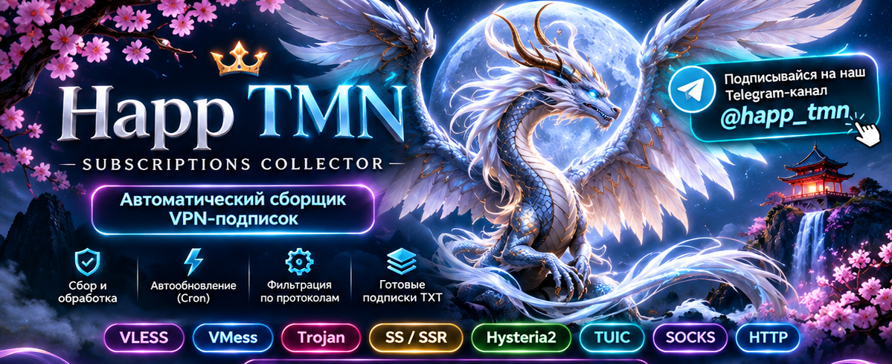

# 🐉 Happ TMN — VPN-подписки для тебя

**Один адрес — много конфигураций. Меньше поисков, больше удобства.**

Мы собираем общедоступные VPN-конфигурации в удобные подборки, чтобы тебе не приходилось искать их по разным сайтам и каналам. Выбирай нужную подписку, добавляй её в приложение и получай обновления автоматически.

**🔄 Обновление каждые 3 часа · 📄 Удобный TXT · 📱 Для Nekobox и совместимых клиентов**

### 💙 [Подписывайся на наш Telegram-канал @happ_tmn](https://t.me/happ_tmn)

Там будем делиться новостями проекта, подборками и полезной информацией о подключении.

---

## ✨ Почему Happ TMN?

- **Всё в одном месте.** VLESS, VMess, Trojan, Shadowsocks, Hysteria2, TUIC и другие конфигурации — в отдельных подписках.
- **Удобно обновлять.** Подборки пересобираются автоматически каждые три часа.
- **Без лишней путаницы.** Мы убираем повторяющиеся записи и добавляем узнаваемую подпись **@happ_tmn**.
- **Настройки подключения остаются на месте.** При переименовании сохраняются адреса, порты, ключи и остальные параметры, а также флаги стран, когда они есть.
- **Особая подборка Reality Vision.** Для тех, кому нужны именно VLESS-конфигурации этого типа.

## 📥 Выбери подписку

**Всего конфигураций: 21,202** · удалено повторов за сборку: **189** · обновлено: **2026-11-08 07:19:36 UTC**.

Нажми «Открыть TXT» или скопируй адрес ссылки в Nekobox.

<!-- HAPP_TMN_COUNTS_START -->
| Подписка | Конфигураций | Ссылка |
|:--|--:|:--|
| 🌍 Все конфигурации | **21,202** | [Открыть TXT](https://raw.githubusercontent.com/happ-tmn/happ-tmn-subscriptions/main/sub/all.txt) |
| 💎 VLESS Reality Vision | **1,794** | [Открыть TXT](https://raw.githubusercontent.com/happ-tmn/happ-tmn-subscriptions/main/sub/vless/reality-vision.txt) |
| 🔐 VLESS Reality | **2,804** | [Открыть TXT](https://raw.githubusercontent.com/happ-tmn/happ-tmn-subscriptions/main/sub/vless/reality.txt) |
| ⚡ VLESS | **20,793** | [Открыть TXT](https://raw.githubusercontent.com/happ-tmn/happ-tmn-subscriptions/main/sub/vless.txt) |
| 📡 VMess | **164** | [Открыть TXT](https://raw.githubusercontent.com/happ-tmn/happ-tmn-subscriptions/main/sub/vmess.txt) |
| 🛡️ Trojan | **70** | [Открыть TXT](https://raw.githubusercontent.com/happ-tmn/happ-tmn-subscriptions/main/sub/trojan.txt) |
| 🌪️ Shadowsocks | **111** | [Открыть TXT](https://raw.githubusercontent.com/happ-tmn/happ-tmn-subscriptions/main/sub/ss.txt) |
| 🌊 ShadowsocksR | **3** | [Открыть TXT](https://raw.githubusercontent.com/happ-tmn/happ-tmn-subscriptions/main/sub/ssr.txt) |
| 🚀 Hysteria2 | **61** | [Открыть TXT](https://raw.githubusercontent.com/happ-tmn/happ-tmn-subscriptions/main/sub/hysteria2.txt) |
| ✨ TUIC | **0** | [Открыть TXT](https://raw.githubusercontent.com/happ-tmn/happ-tmn-subscriptions/main/sub/tuic.txt) |
| 🌐 WebSocket | **15,584** | [Открыть TXT](https://raw.githubusercontent.com/happ-tmn/happ-tmn-subscriptions/main/sub/ws.txt) |
| 📦 XHTTP | **1,240** | [Открыть TXT](https://raw.githubusercontent.com/happ-tmn/happ-tmn-subscriptions/main/sub/xhttp.txt) |
| 🧩 gRPC | **670** | [Открыть TXT](https://raw.githubusercontent.com/happ-tmn/happ-tmn-subscriptions/main/sub/grpc.txt) |
| 🔒 TLS | **14,027** | [Открыть TXT](https://raw.githubusercontent.com/happ-tmn/happ-tmn-subscriptions/main/sub/tls.txt) |
| 🔐 Reality | **2,804** | [Открыть TXT](https://raw.githubusercontent.com/happ-tmn/happ-tmn-subscriptions/main/sub/reality.txt) |
| 🔓 Без TLS / Reality | **4,362** | [Открыть TXT](https://raw.githubusercontent.com/happ-tmn/happ-tmn-subscriptions/main/sub/none.txt) |
| 🔌 TCP | **3,194** | [Открыть TXT](https://raw.githubusercontent.com/happ-tmn/happ-tmn-subscriptions/main/sub/tcp.txt) |
| 🔗 HTTPUpgrade | **261** | [Открыть TXT](https://raw.githubusercontent.com/happ-tmn/happ-tmn-subscriptions/main/sub/httpupgrade.txt) |
| 📨 HTTP/2 | **0** | [Открыть TXT](https://raw.githubusercontent.com/happ-tmn/happ-tmn-subscriptions/main/sub/h2.txt) |
| ⚡ VLESS TLS WS | **11,870** | [Открыть TXT](https://raw.githubusercontent.com/happ-tmn/happ-tmn-subscriptions/main/sub/vless/tls/ws.txt) |
| 📦 VLESS XHTTP | **1,240** | [Открыть TXT](https://raw.githubusercontent.com/happ-tmn/happ-tmn-subscriptions/main/sub/vless/xhttp.txt) |
| 🛡️ Trojan TLS | **54** | [Открыть TXT](https://raw.githubusercontent.com/happ-tmn/happ-tmn-subscriptions/main/sub/trojan/tls.txt) |
| 📡 VMess TLS WS | **65** | [Открыть TXT](https://raw.githubusercontent.com/happ-tmn/happ-tmn-subscriptions/main/sub/vmess/tls/ws.txt) |
<!-- HAPP_TMN_COUNTS_END -->

> Цифры показывают число записей, **не** количество проверенных работающих серверов. Одна конфигурация может входить в несколько тематических подборок.

## 📲 Как подключить в Nekobox

1. Выбери подписку в таблице и **скопируй адрес ссылки**.
2. Открой Nekobox и найди раздел **«Подписки»**.
3. Добавь новую подписку **по URL** и вставь ссылку.
4. Запусти обновление подписки и выбери подходящий узел.

Названия пунктов меню могут немного отличаться в зависимости от версии приложения. Эти же TXT-ссылки можно использовать в других клиентах, которые умеют импортировать соответствующие протоколы.

## ❓ Полезно знать

**Подписка — это не отдельный VPN-сервер.** Happ TMN собирает и упорядочивает опубликованные конфигурации. Некоторые узлы со временем перестают работать, а скорость и доступность зависят от самих серверов.

**Почему в отдельной подписке может быть мало узлов?** В источниках не всегда есть конфигурации каждого типа. Например, Reality Vision встречается не в каждой подборке.

**Почему названия выглядят одинаково?** Мы приводим их к единому стилю **@happ_tmn**, чтобы подборки было проще узнать, но параметры подключения не меняем.

---

### 🐉 Оставайся с Happ TMN!

Хочешь получать новости, новые подборки и обновления проекта?

### 👉 [Подписаться на Telegram @happ_tmn](https://t.me/happ_tmn)

**Спасибо, что ты с нами! 💙**

